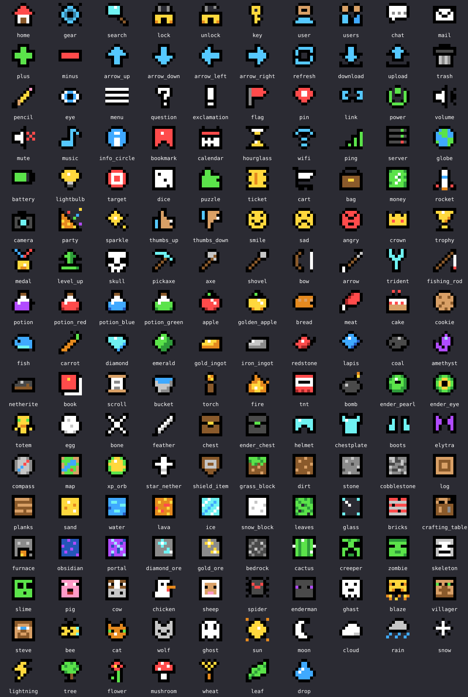

# PixelUI — кастомный пиксельный интерфейс

PixelUI состоит из двух частей:

| Часть | Файл | Куда |
|---|---|---|
| Клиентский мод (Fabric 1.21.11) | `PixelUI-1.1.0.jar` | ставится сам через ModSync |
| Серверный плагин (Paper 1.21.11) | `PixelUI-Paper-1.1.0.jar` | `plugins/` |

Мод рисует настоящий кастомный интерфейс: всплывающие уведомления (тосты), плашки и меню-экраны в пиксельном стиле.
Плагин даёт API другим плагинам. Если у игрока нет мода, плагин показывает запасной вариант (чат / actionbar / title / bossbar).

## Плагин: подключение

`plugin.yml` вашего плагина:

```yaml
depend: [PixelUI]
```

Gradle: `compileOnly(files("libs/PixelUI-Paper-1.1.0.jar"))`.

## Плагин: уведомления

```java
PixelNotification.builder()
    .title("&aКвест выполнен")          // &-коды или MiniMessage
    .text("Награда: &e50 монет")        // \n — новая строка
    .icon(PixelIcon.COIN)               // или PixelIcon.item(Material.DIAMOND)
    .theme(PixelTheme.GOLD)             // или PixelTheme.DARK.accent(0x55FFFF)
    .position(PixelPosition.TOP_RIGHT)
    .duration(Duration.ofSeconds(6))
    .sound("minecraft:entity.player.levelup")
    .send(player);

PixelUI.notify(player, "Заголовок", "Текст");   // коротко
PixelUI.notifyAll(notification);                  // всем онлайн
```

Уведомление с тем же `id(...)` обновляется на месте (удобно для таймеров).

## Плагин: плашки

```java
PixelBanner.builder("event")
    .text("&eИвент закончится через 5:00")
    .icon(PixelIcon.CLOCK).theme(PixelTheme.WARNING)
    .progress(0.4f)          // -1 — без полоски
    .duration(0)             // 0 — пока не уберут
    .send(player);

PixelUI.removeBanner(player, "event");   // null — все плашки
```

## Плагин: меню

```java
PixelMenu.builder("shop")
    .title("&6Магазин").icon(PixelIcon.COIN).theme(PixelTheme.GOLD)
    .columns(2).width(240)
    .line("Баланс: &e120 монет")
    .button("buy", "Купить", b -> b.style(PixelButtonStyle.SUCCESS)
            .icon(PixelIcon.item(Material.DIAMOND)).tooltip("64 алмаза")
            .closes().onClick(p -> buy(p)))
    .button("cancel", "Отмена", b -> b.style(PixelButtonStyle.DANGER).closes())
    .onClose(p -> { /* меню закрыто */ })
    .open(player);
```

Обработчики вызываются в главном потоке сервера. Методы `PixelUI.*` можно вызывать из любого потока.

### События

- `PixelClientReadyEvent` — у игрока есть мод (пришёл hello).
- `PixelMenuClickEvent` — нажата кнопка, можно отменить.
- `PixelMenuCloseEvent` — меню закрыто, причина: PLAYER, BUTTON, REPLACED, SERVER, QUIT.

## Плагин: вопросы Да (Y) / Нет (N)

Плашка с вопросом: игрок с модом отвечает клавишами прямо в игре (без открытия экрана),
игрок без мода — кнопками `[Да] [Нет]` в чате (`fallback.prompt: chat`).

```java
PixelPrompt.builder("clan-invite")
    .question("&eВас пригласили в клан &6Dragons")
    .text("Принять приглашение?")
    .icon(PixelIcon.SHIELD).theme(PixelTheme.GOLD)
    .position(PixelPosition.TOP_CENTER)      // TOP_CENTER | CENTER | BOTTOM_CENTER
    .timeout(Duration.ofSeconds(20))         // 0 = без лимита
    .yesLabel("Принять").noLabel("Отказать")
    .keys('Y', 'N')                          // свои клавиши: A–Z, 0–9
    .colors(0x3FA535, 0xC83737)              // цвета клавиш
    .timerBar(true).width(260).sound("minecraft:block.note_block.pling")
    .onYes(p -> clans.join(p, "Dragons"))
    .onNo(p -> p.sendMessage("Отказано"))
    .onTimeout(p -> p.sendMessage("Время вышло"))
    .onAnswer((p, answer) -> log(p, answer)) // YES / NO / TIMEOUT / CANCELLED
    .send(player);

// Коротко:
PixelUI.ask(player, "tp-request", "&bПринять телепорт от Steve?", answer -> { ... });
PixelUI.cancelPrompt(player, "tp-request");   // null — все вопросы
PixelUI.hasPrompt(player, "tp-request");
```

- Тот же `id` заменяет старый вопрос (старый получает `CANCELLED`).
- Несколько разных вопросов встают в очередь (до 16), на плашке виден счётчик `+N`.
- Засчитывается только первый ответ; сервер страхует тайм-аут своим таймером.
- Клавиши читаются, только когда не открыт экран (чат, инвентарь) — случайно ответить, печатая в чате, нельзя.
- Событие `PixelPromptAnswerEvent` (getPlayer, getPromptId, getAnswer, isFallback) приходит для вопросов любого плагина.
  Если отменить событие, обработчики onYes/onNo/… не вызываются.

### Клиентский мод: вопросы из других модов

```java
PixelUI.prompt(Prompt.builder("mymod-confirm")
        .question("Сбросить настройки?").text("Действие нельзя отменить")
        .icon("warn").theme(Theme.WARNING).timeout(10_000)
        .yesLabel("Сбросить").yesKey('Y').noKey('N')
        .build(),
    answer -> { if (answer == PromptAnswer.YES) resetConfig(); });
PixelUI.cancelPrompt("mymod-confirm");
PixelUI.hasPrompt();
```

## Плагин: окна ввода (формы)

До 5 полей (текст или пароль), таймер, текст ошибки, кнопки «Готово»/«Отмена». Именно им пользуется PixelAuth.

```java
PixelInput form = PixelInput.builder("myplugin-promo")
        .title("Промокод")
        .line("Введите код из Discord")
        .icon(PixelIcon.GIFT).theme(PixelTheme.GOLD)
        .field(PixelInput.Field.text("Код").placeholder("ABCD-1234").maxLength(16))
        .submit("Активировать").cancel("Отмена")
        .closeOnSubmit(false)          // закрыть сами, когда проверим
        .onSubmit((player, values) -> {
            if (!valid(values.get(0))) PixelUI.inputError(player, "myplugin-promo", "Неверный код");
            else PixelUI.closeInput(player, "myplugin-promo");
        })
        .build();
if (!PixelUI.input(player, form)) { /* у игрока нет мода — спросите в чате */ }
```

`Field.password(...)` прячет символы; `closeable(false)` — окно не закрывается по Esc; `timer(60)` — обратный отсчёт.

## Справочник

- Темы: `dark, stone, success, error, warning, info, gold, ender, nether`; свои цвета: `accent, bg, outline, light, dark, title, text` (0xRRGGBB или 0xAARRGGBB), `shadow(bool)`.
- Иконки: 283 встроенных пиксельных (см. «Встроенные иконки» ниже), `item:<id предмета>`, `none`.
- Позиции: `TOP_LEFT, TOP_CENTER, TOP_RIGHT, CENTER, BOTTOM_LEFT, BOTTOM_CENTER, BOTTOM_RIGHT`.
- Стили кнопок: `default, primary, success, danger, info, gold` или свой цвет `color(0xRRGGBB)`.
- Лимиты: 5 тостов в одном углу, 18 кнопок и 30 строк в меню, 1–3 столбца.

## Встроенные иконки

Всего 283 иконок 8×8, нарисованных вручную. Используйте по имени: в моде `.icon("diamond")`, в плагине `.icon(PixelIcon.DIAMOND)`.
Иконки с акцентным цветом (стрелки, шестерёнка, флаги и др.) сами перекрашиваются под тему уведомления.



- **Базовые:** `info`, `check`, `cross`, `warn`, `star`, `heart`, `coin`, `bell`, `gift`, `sword`, `shield`, `clock`
- **Интерфейс и символы:** `home`, `gear`, `search`, `lock`, `unlock`, `key`, `user`, `users`, `chat`, `mail`, `plus`, `minus`, `arrow_up`, `arrow_down`, `arrow_left`, `arrow_right`, `refresh`, `download`, `upload`, `trash`, `pencil`, `eye`, `menu`, `question`, `exclamation`, `flag`, `pin`, `link`, `power`, `volume`, `mute`, `music`, `info_circle`, `bookmark`, `calendar`, `hourglass`, `wifi`, `ping`, `server`, `globe`, `battery`, `lightbulb`, `target`, `dice`, `puzzle`, `ticket`, `cart`, `bag`, `money`, `rocket`, `camera`, `party`, `sparkle`, `thumbs_up`, `thumbs_down`, `smile`, `sad`, `angry`, `crown`, `trophy`, `medal`, `level_up`, `skull`
- **Предметы:** `pickaxe`, `axe`, `shovel`, `bow`, `arrow`, `trident`, `fishing_rod`, `potion`, `potion_red`, `potion_blue`, `potion_green`, `apple`, `golden_apple`, `bread`, `meat`, `cake`, `cookie`, `fish`, `carrot`, `diamond`, `emerald`, `gold_ingot`, `iron_ingot`, `redstone`, `lapis`, `coal`, `amethyst`, `netherite`, `book`, `scroll`, `bucket`, `torch`, `fire`, `tnt`, `bomb`, `ender_pearl`, `ender_eye`, `totem`, `egg`, `bone`, `feather`, `chest`, `ender_chest`, `helmet`, `chestplate`, `boots`, `elytra`, `compass`, `map`, `xp_orb`, `star_nether`, `shield_item`
- **Блоки:** `grass_block`, `dirt`, `stone`, `cobblestone`, `log`, `planks`, `sand`, `water`, `lava`, `ice`, `snow_block`, `leaves`, `glass`, `bricks`, `crafting_table`, `furnace`, `obsidian`, `portal`, `diamond_ore`, `gold_ore`, `bedrock`, `cactus`
- **Мобы:** `creeper`, `zombie`, `skeleton`, `slime`, `pig`, `cow`, `chicken`, `sheep`, `spider`, `enderman`, `ghast`, `blaze`, `villager`, `steve`, `bee`, `cat`, `wolf`, `ghost`
- **Природа и погода:** `sun`, `moon`, `cloud`, `rain`, `snow`, `lightning`, `tree`, `flower`, `mushroom`, `wheat`, `leaf`, `drop`
- **Оружие, броня и инструменты:** `sword_wood`, `sword_stone`, `sword_iron`, `sword_gold`, `sword_diamond`, `sword_netherite`, `sword_magic`, `pants`, `leggings_leather`, `leggings_chain`, `leggings_iron`, `leggings_gold`, `leggings_diamond`, `leggings_netherite`, `helmet_leather`, `chestplate_leather`, `boots_leather`, `helmet_iron`, `chestplate_iron`, `boots_iron`, `helmet_gold`, `chestplate_gold`, `boots_gold`, `helmet_netherite`, `chestplate_netherite`, `boots_netherite`, `pickaxe_wood`, `pickaxe_stone`, `pickaxe_iron`, `pickaxe_gold`, `pickaxe_netherite`, `axe_gold`, `axe_diamond`, `axe_netherite`, `shovel_gold`, `shovel_diamond`, `hoe`, `hoe_diamond`, `crossbow`, `mace`, `dagger`, `hammer`, `wand`, `staff`, `swords_crossed`
- **Еда:** `watermelon`, `pumpkin`, `pumpkin_pie`, `potato`, `beetroot`, `berries`, `honey`, `milk`, `golden_carrot`, `stew`
- **Предметы (набор 2):** `enchanted_book`, `string`, `slimeball`, `gunpowder`, `blaze_rod`, `name_tag`, `paper`, `spyglass`, `lantern`, `music_disc`, `firework`, `snowball`, `spawn_egg`, `bottle`, `saddle`
- **Блоки (набор 2):** `iron_block`, `gold_block`, `diamond_block`, `emerald_block`, `redstone_block`, `lapis_block`, `netherrack`, `end_stone`, `glowstone`, `sponge`, `beacon`, `anvil`, `bookshelf`, `hay_bale`, `magma`
- **Мобы (набор 2):** `rabbit`, `fox`, `panda`, `frog`, `axolotl`, `squid`, `witch`, `iron_golem`, `piglin`, `phantom`
- **Интерфейс (набор 2):** `play`, `pause`, `stop`, `checkbox`, `checkbox_checked`, `heart_empty`, `heart_half`, `star_empty`, `crosshair`

Своя иконка — строки из символов палитры (`.` — пусто):
`k` контур, `w` белый, `y` жёлтый, `o` оранжевый, `r` красный, `v` тёмно-красный, `g` зелёный, `e` тёмно-зелёный, `b` синий, `u` тёмно-синий, `c` голубой, `p` фиолетовый, `i` розовый, `n` коричневый, `t` бежевый, `s` серый, `h` светло-серый, `m` тёмно-серый, `a`/`d`/`l` акцент темы / темнее / светлее.

## Клиентский мод: API для других модов

```java
import my.yeamu.pixelui.api.*;

PixelUI.notify(Notification.builder().title("Привет").text("Из моего мода")
        .icon("star").theme(Theme.ENDER).build());
PixelUI.banner(...);
PixelUI.openMenu(menu, (m, button) -> { /* нажатие */ });
PixelUI.registerIcon("my_icon", new String[]{ /* 16 строк пикселей */ });
PixelUI.serverHasPlugin();
```

В `fabric.mod.json` вашего мода: `"depends": { "pixelui": "*" }`.

## Команды (право `pixelui.admin`)

- `/pixelui notify <игрок|*> <тема> <заголовок | текст>`
- `/pixelui banner <игрок|*> <id> <секунд> <текст>`
- `/pixelui unbanner <игрок|*> [id]`, `/pixelui clear <игрок|*>`
- `/pixelui demo [игрок]` — показать всё сразу
- `/pixelui status [игрок]`, `/pixelui reload`

## config.yml

```yaml
fallback:
  notify: chat      # chat | actionbar | title | none
  banner: bossbar   # bossbar | actionbar | none
  menu: chat        # chat (кликабельные кнопки) | none
log-hello: true
```

## Протокол (канал `pixelui:main`)

Пакет: VarInt длина + UTF-8 JSON. Поле `type`:

- сервер → клиент: `notify`, `banner`, `banner_remove`, `clear`, `menu`, `menu_close`;
- клиент → сервер: `hello {version}`, `click {menu, button}`, `close {menu}`.

HEX-цвета в тексте округляются до 16 стандартных; HEX в темах работает полностью.

Вопросы Да/Нет (с 1.1.0):

- сервер → клиент: `{"type":"prompt", "id", "question", "text", "icon", "theme", "position", "timeout", "yes", "no", "yesKey", "noKey", "yesColor", "noColor", "timerBar", "width", "sound"}`, `{"type":"prompt_cancel", "id"?}`
- клиент → сервер: `{"type":"answer", "id", "answer": "yes"|"no"|"timeout"}`
